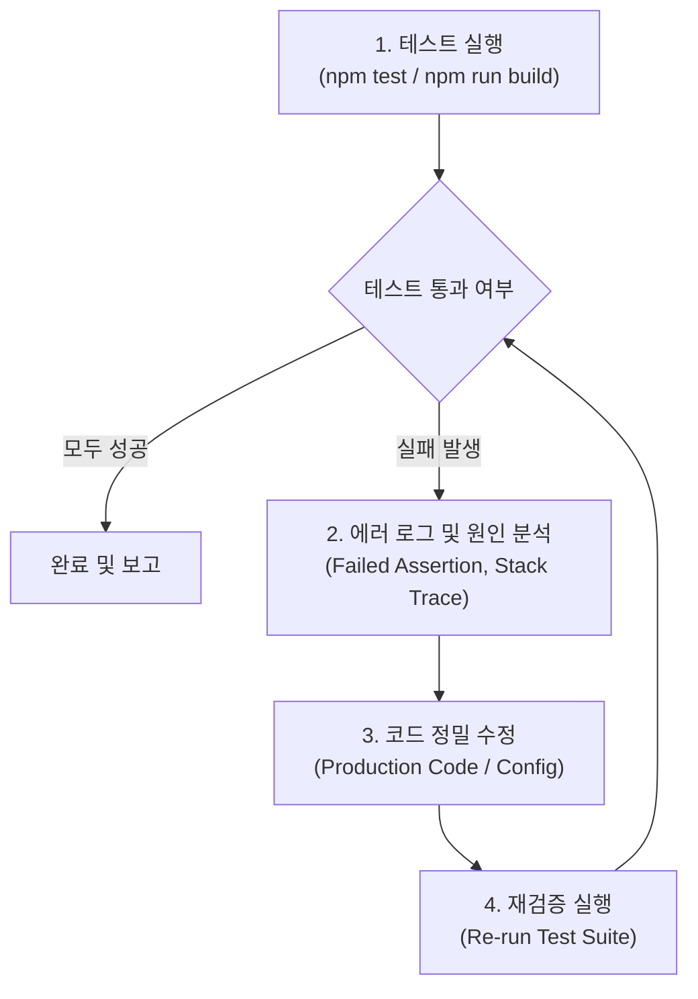

# Auto Test & Fix Skill (자동 테스트 및 결함 자율 수정)

이 스킬은 프로젝트의 테스트 스위트(`npm test`, `npm run build`, E2E 등)를 실행하여 결함을 감지하고, 원인을 분석한 뒤 코드를 자동으로 수정하여 테스트를 100% 통과하도록 만드는 자율 워크플로우를 제공합니다.

---

## 🎯 핵심 원칙 (Core Principles)

1. **테스트 우선 검증 (Test-First Verification)**:
   - 추측으로 코드를 수정하지 않고, 항상 테스트 실행 로그와 실패 Assertion을 바탕으로 정확한 원인을 진단합니다.
2. **최소 침습 수정 (Minimal Invasive Fix)**:
   - 버그를 해결하는 데 꼭 필요한 최소한의 영역만 수정하며, 기존 기능이나 무관한 코드를 임의로 변경하지 않습니다.
3. **무한 루프 방지 (Max 3 Retry Attempts)**:
   - 수정 후 테스트를 재실행하여 통과 여부를 검증하며, 동일 오류가 3회 이상 지속되면 전략을 재수립하거나 사용자에게 선택지를 제시합니다.
4. **회귀 방지 (No Regression)**:
   - 수정 대상 테스트뿐만 아니라 전체 테스트 스위트를 재실행하여 다른 기능이 깨지지 않았는지 확인합니다.

---

## 🔄 워크플로우 4단계



### 단계 1: 테스트 실행 (Diagnose)
- 프로젝트의 테스트 명령어를 실행합니다.
  ```bash
  npm test
  npm run build
  ```
- 실행 결과를 파싱하여 실패한 테스트 함수, 파일명, 실패 이유(Expected vs Actual)를 추출합니다.

### 단계 2: 에러 원인 분석 (Analyze)
- 실패한 지점의 코드 컨텍스트를 파악합니다:
  - **Type/Build Error**: 누락된 import, 타입 불일치, 매개변수 누락
  - **Logic Error / Assertion Fail**: 잘못된 조건문, 정렬/필터링 버그, 메타데이터 파싱 실패
  - **Async / Timeout Error**: 과도하게 짧은 타임아웃, Promise 누락, Race Condition
  - **Data/Payload Error**: 대용량 base64/이미지 처리 누락, Null/Undefined 참조

### 단계 3: 자율 코드 수정 (Fix)
- 식별된 원인에 맞춰 코드를 직접 수정합니다.
- 수정 시 기존 주석, 스타일 규칙(CRLF/LF, 들여쓰기)을 유지합니다.

### 단계 4: 재검증 및 커밋 (Verify & Report)
- 전체 테스트 스위트(`npm test`)와 빌드(`npm run build`)를 재실행합니다.
- 모든 테스트가 통과하면:
  - 수정된 파일 목록
  - 결함의 근본 원인 (Root Cause)
  - 수정 내용 요약
  을 사용자에게 명확히 보고합니다.

---

## 🛠️ 권장 명령어 매핑

- **단위 테스트 실행**: `npm test` 또는 `node --test scripts/run-unit-tests.mjs`
- **Next.js 프로덕션 빌드 검사**: `npm run build`
- **린트 검사**: `npm run lint`
